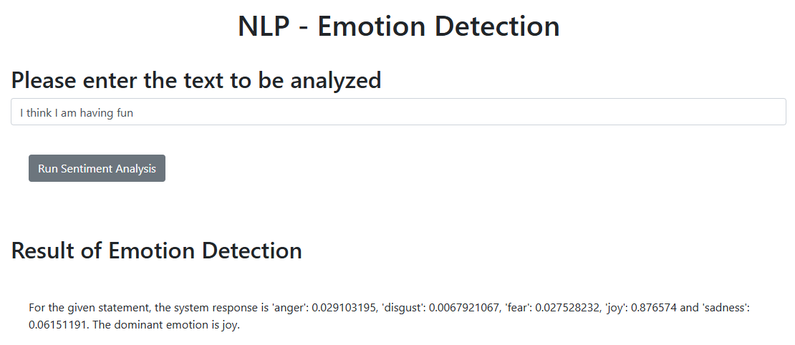
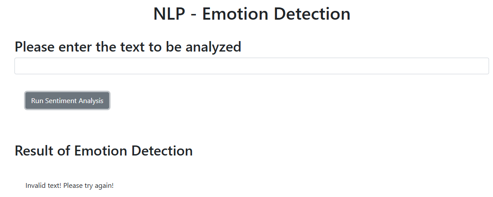

# Final project

## AI-Powered Emotion Detection Web Application

**IBM Full Stack Software Developer Professional Certificate**  
**Course:** Build & Deploy AI Applications with Python & Flask  
**Project Type:** AI-Based Web Application Development and Deployment  
**Technologies:** Python · Flask · IBM Watson NLP · REST API · Requests · Unittest · Pylint

---

## 1. Project Overview

The **AI-Powered Emotion Detection Web Application** is a Python-based web application that analyzes textual input and identifies emotions expressed within the text using IBM Watson Natural Language Processing (NLP).

Developed as part of the IBM Full Stack Software Developer Professional Certificate, this project demonstrates the integration of AI services into a functional web application using Python and Flask.

The application accepts customer feedback in text format, processes it through the IBM Watson NLP EmotionPredict API, and returns individual emotion scores together with the dominant emotion.

### Business Scenario

An e-commerce company requires an AI-powered application to analyze customer feedback about its products.

Traditional sentiment analysis typically classifies feedback as positive, negative, or neutral. Emotion detection provides more granular insights by identifying specific emotions such as joy, anger, sadness, fear, and disgust.

This functionality can support customer feedback analysis, product experience evaluation, and the development of more intelligent customer engagement systems.

## 2. Key Features

- **AI-powered emotion detection:** Integrates with IBM Watson NLP to analyze textual feedback.
- **Five-emotion classification:** Evaluates anger, disgust, fear, joy, and sadness.
- **Dominant emotion identification:** Determines the emotion with the highest returned score.
- **Flask web interface:** Provides a browser-based interface for entering and analyzing text.
- **REST-style endpoint:** Processes input through the `/emotionDetector` endpoint.
- **Input error handling:** Displays a clear message when blank input is submitted.
- **Automated testing:** Validates five predefined emotion-detection scenarios.
- **Static code analysis:** Uses Pylint to evaluate Python code quality.
- **Git version control:** Maintains project source code and assignment evidence.

## 3. Technology Stack

| Technology | Purpose |
|---|---|
| Python 3 | Core application and backend logic |
| Flask | Web application framework and HTTP routing |
| IBM Watson NLP | Emotion prediction and analysis |
| Requests | HTTP communication with Watson NLP |
| JSON | Processing API responses |
| HTML | Web interface structure |
| JavaScript | Frontend interaction and API requests |
| Python Unittest | Automated application testing |
| Pylint | Static code analysis |
| Git and GitHub | Version control and evidence management |

## 4. System Architecture

The application follows a client-server architecture, with Flask serving as the intermediary between the web interface and the IBM Watson NLP service.

```text
Customer / Web Browser
         |
         | Enters text feedback
         v
HTML and JavaScript Interface
         |
         | GET /emotionDetector
         | Parameter: textToAnalyze
         v
Flask Application (server.py)
         |
         | Calls emotion_detector()
         v
EmotionDetection Python Package
         |
         | HTTP POST Request
         v
IBM Watson NLP EmotionPredict API
         |
         | JSON Emotion Predictions
         v
Emotion Detection Processing
         |
         | Extract five emotion scores
         | Identify dominant emotion
         v
Flask Response Formatting
         |
         v
Web Browser Displays Results
```

### Processing Workflow

1. The user enters a sentence into the web interface.
2. JavaScript sends the text to the Flask `/emotionDetector` endpoint.
3. Flask passes the text to the `emotion_detector()` function.
4. The Python function submits an HTTP POST request to the Watson NLP EmotionPredict service.
5. Watson NLP returns emotion predictions.
6. The application extracts the five emotion scores and determines the dominant emotion.
7. Flask formats the results and returns them to the browser.
8. If invalid or blank input produces an HTTP 400 response from Watson NLP, the application displays an error message.

## 5. Project Structure

```text
oaqjp-final-project-emb-ai/
|
├── EmotionDetection/
│   ├── __init__.py
│   └── emotion_detection.py
|
├── static/
│   └── mywebscript.js
|
├── templates/
│   └── index.html
|
├── submission_evidence/
│   ├── Q01_README_URL.md
│   ├── 2a_emotion_detection.txt
│   ├── 2b_application_creation.txt
│   ├── 3a_output_formatting.txt
│   ├── 3b_formatted_output_test.txt
│   ├── 4a_packaging_URL.md
│   ├── 4b_packaging_test.txt
│   ├── 5a_unit_testing.txt
│   ├── 5b_unit_testing_result.txt
│   ├── 6a_server.txt
│   ├── 6b_deployment_test.png
│   ├── 7a_error_handling_function.txt
│   ├── 7b_error_handling_server.txt
│   ├── 7c_error_handling_interface.png
│   ├── 8a_server_modified.txt
│   └── 8b_static_code_analysis.txt
|
├── server.py
├── test_emotion_detection.py
├── README.md
├── LICENSE
└── .gitignore
```

### Key Components

**`EmotionDetection/emotion_detection.py`**

Contains the `emotion_detector()` function responsible for sending requests to Watson NLP, processing the response, extracting emotion scores, and handling HTTP 400 responses.

**`EmotionDetection/__init__.py`**

Exposes the emotion detection function as an importable Python package.

**`server.py`**

Implements the Flask application, including the web routes, response formatting, and invalid-input handling.

**`test_emotion_detection.py`**

Contains automated tests that verify the dominant emotion returned for five predefined statements.

**`templates/index.html` and `static/mywebscript.js`**

Provide the preconfigured frontend interface supplied by IBM.

**`submission_evidence/`**

Stores code snapshots, terminal outputs, and screenshots corresponding to the 16 AI-graded submission questions.

## 6. Installation and Setup

### Prerequisites

- Python 3
- Git
- Python pip
- Flask
- Requests
- IBM Skills Network Theia Lab environment

**Important:** The Watson NLP endpoint used in this project is provided through the IBM Skills Network lab environment. The application was developed and tested in Theia and is not configured as a standalone public production deployment.

### Step 1 — Clone the Repository

```bash
git clone https://github.com/cyber-sekuro/oaqjp-final-project-emb-ai.git

cd oaqjp-final-project-emb-ai
```

### Step 2 — Install Dependencies

```bash
python3 -m pip install requests flask
```

For static analysis, install Pylint:

```bash
python3 -m pip install pylint
```

### Step 3 — Start the Flask Server

```bash
python3 server.py
```

The development server runs at:

```text
http://localhost:5000
```

### Step 4 — Open the Application

Open the application using the IBM Skills Network Theia browser preview or port-5000 application launcher.

Enter a sentence into the text field and select **Run Sentiment Analysis**.

The application will display the detected emotion scores and the dominant emotion.

## 7. Watson NLP Integration

The application communicates with the IBM Watson NLP EmotionPredict service using an HTTP POST request.

### API Endpoint

```text
https://sn-watson-emotion.labs.skills.network/v1/watson.runtime.nlp.v1/NlpService/EmotionPredict
```

### Request Header

```json
{
  "grpc-metadata-mm-model-id": "emotion_aggregated-workflow_lang_en_stock"
}
```

### Request Body

```json
{
  "raw_document": {
    "text": "I love this new technology."
  }
}
```

### Emotion Detection Output

The application processes the Watson NLP response into a Python dictionary with the following structure:

```python
{
    "anger": anger_score,
    "disgust": disgust_score,
    "fear": fear_score,
    "joy": joy_score,
    "sadness": sadness_score,
    "dominant_emotion": dominant_emotion
}
```

The dominant emotion is selected based on the highest returned emotion score.

## 8. Application Demonstration

### Example: Positive Customer Feedback

**Input:**

```text
I am so happy I am doing this.
```

**Actual Watson NLP Response:**

```python
{
    'anger': 0.0043339236,
    'disgust': 0.00037549555,
    'fear': 0.0034732423,
    'joy': 0.9947189,
    'sadness': 0.012704818,
    'dominant_emotion': 'joy'
}
```

**Result:** The dominant emotion is `joy`.

### Example: Negative Customer Feedback

**Input:**

```text
I hate working long hours
```

**Actual Watson NLP Response:**

```python
{
    'anger': 0.64949876,
    'disgust': 0.03718168,
    'fear': 0.05612277,
    'joy': 0.00862553,
    'sadness': 0.1955148,
    'dominant_emotion': 'anger'
}
```

**Result:** The dominant emotion is `anger`.

### Web Application Screenshot



The screenshot demonstrates the running Flask application processing the required test statement:

```text
I think I am having fun
```

## 9. Error Handling

The application incorporates error handling for blank input.

When Watson NLP returns HTTP status code `400`, the `emotion_detector()` function returns:

```python
{
    "anger": None,
    "disgust": None,
    "fear": None,
    "joy": None,
    "sadness": None,
    "dominant_emotion": None
}
```

The Flask application checks the returned `dominant_emotion` value.

If the value is `None`, the application displays:

```text
Invalid text! Please try again!
```

### Error Handling Screenshot



This behavior was verified in the IBM Skills Network Theia environment.

## 10. Automated Unit Testing

The project uses Python's built-in `unittest` framework to validate emotion detection behavior.

### Test Cases

| Test Statement | Expected Emotion | Result |
|---|---|---|
| I am glad this happened | joy | Passed |
| I am really mad about this | anger | Passed |
| I feel disgusted just hearing about this | disgust | Passed |
| I am so sad about this | sadness | Passed |
| I am really afraid that this will happen | fear | Passed |

### Running the Tests

```bash
python3 test_emotion_detection.py -v
```

### Verified Test Result

```text
Ran 5 tests in 0.541s

OK
```

**Test Summary:**

- Total tests: 5
- Passed: 5
- Failed: 0
- Errors: 0

The tests execute the real emotion detection function against the lab-hosted Watson NLP service.

## 11. Static Code Analysis

Pylint was used to analyze the Flask application source code for code-quality issues and Python coding conventions.

### Run Pylint

```bash
python3 -m pylint server.py
```

### Final Analysis Result

```text
Your code has been rated at 10.00/10
```

**Pylint Score: 10.00/10**

The final score was achieved after correcting formatting issues in `server.py`.

Functionality was subsequently verified by rerunning all five emotion detection tests successfully.

## 12. Project Completion Summary

The project was implemented across eight assessment tasks.

| Task | Deliverable | Status |
|---|---|---|
| Task 1 | Fork and clone GitHub repository | Completed |
| Task 2 | Implement Watson NLP emotion detection | Completed |
| Task 3 | Format emotion detection output | Completed |
| Task 4 | Create the EmotionDetection Python package | Completed |
| Task 5 | Execute automated unit tests | Completed |
| Task 6 | Deploy the application using Flask | Completed |
| Task 7 | Implement blank-input error handling | Completed |
| Task 8 | Achieve Pylint 10.00/10 | Completed |

All implementation tasks were completed and their supporting evidence was committed to GitHub.

## 13. Project Limitations

This application was developed as an educational project within the IBM Skills Network environment.

Current limitations include:

- **Environment dependency:** The Watson NLP endpoint is hosted by IBM Skills Network and is not intended as a general-purpose production API.
- **English-language model:** The configured Watson NLP model is designed for English-language emotion analysis.
- **Network dependency:** Emotion detection requires access to the external Watson NLP service.
- **Development server:** Flask's built-in development server is used for demonstration and testing, not production hosting.
- **Error handling scope:** The project implements the blank-input behavior required by the assignment. Comprehensive handling for network timeouts, service outages, and unexpected responses has not been implemented.
- **Testing scope:** The tests verify predefined cases against the real API; they are not a complete automated production test suite.

Production deployment would require an independently supported NLP service, secure configuration management, request timeouts, additional error handling, monitoring, and a production-ready application server.

## 14. Skills Demonstrated

This project demonstrates practical experience in:

- Python application development and modular programming.
- Integrating external AI services using HTTP APIs.
- Processing and transforming JSON responses.
- Designing reusable Python packages.
- Developing Flask routes and backend functionality.
- Integrating frontend and backend components.
- Implementing basic input validation and error handling.
- Creating and executing automated tests.
- Applying static code analysis and coding standards.
- Maintaining project source code and assessment evidence using Git and GitHub.

## 15. References and Acknowledgements

This project was completed as part of the **Build & Deploy AI Applications with Python & Flask** course within the **IBM Full Stack Software Developer Professional Certificate**.

The original starter repository, HTML template, JavaScript resources, and educational project requirements were supplied by IBM Skills Network.

- **Original Repository:** https://github.com/ibm-developer-skills-network/oaqjp-final-project-emb-ai
- **Project Repository:** https://github.com/cyber-sekuro/oaqjp-final-project-emb-ai
- **Course Provider:** IBM / Coursera

### Licensing

The project is based on IBM-provided educational resources. Refer to the repository's `LICENSE` file for the applicable software license and usage terms.

---

**Project Status:** Completed  
**Development Environment:** IBM Skills Network Theia Lab  
**Source Code and Evidence:** GitHub  
**Static Analysis:** Pylint 10.00/10  
**Automated Tests:** 5/5 Passed
